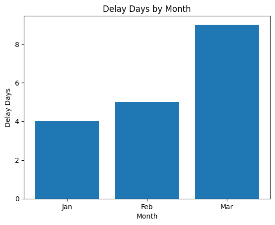
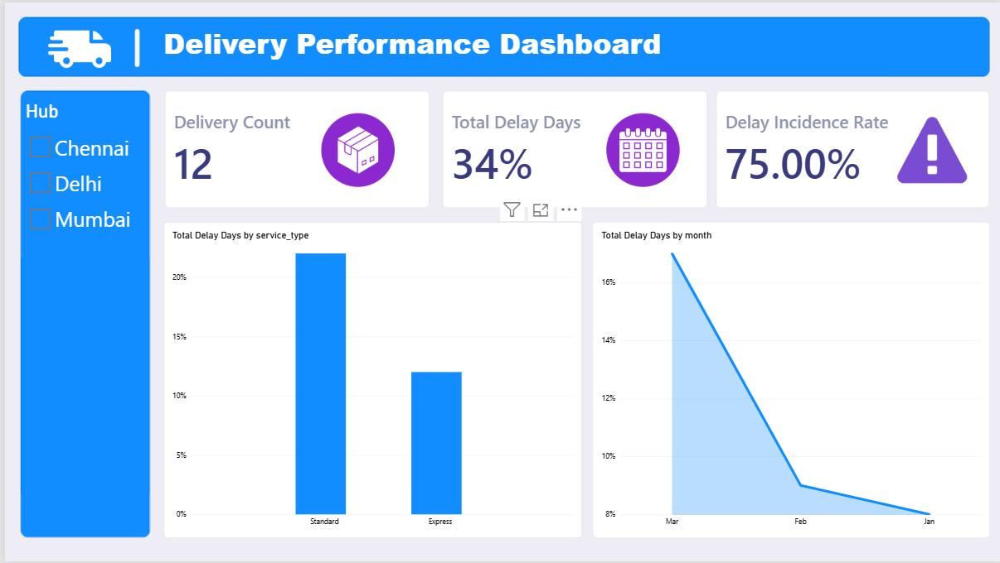

# Delivery Delay Analysis — Practical Exam (Data Analysis)

| | |
|---|---|
| **Student name** | Om Vaja |
| **Student ID** | 9697 |
| **Assigned set** | Set A |
| **Institute** | Red & White Skill Education |

---

## 1. Business Objective

A logistics company wants to understand **where and why deliveries run late**. Using a small fact table of deliveries and a route lookup table, this project measures delay in days, finds the biggest sources of delay, and presents the results consistently across four tools: **Excel, SQL, Python and Power BI**.

### Business questions answered
1. **Which service type (Express vs Standard) contributes the most delay, and how often are its deliveries late?**
2. **Which single route has the greatest total delay, and what share of the overall delay does it account for?**

(Supporting views: monthly delay trend Jan → Mar, and top hubs by delay.)

---

## 2. Project Folder Structure

```
data-analysis-set-d-9697/
├── data/
│   └── raw/
│       ├── deliveries.csv        # fact file (13 rows incl. 1 duplicate)
│       └── routes.csv            # lookup file (4 rows)
├── excel/
│   └── analysis.xlsx             # Raw, Lookup, Clean, Summary sheets
├── sql/
│   ├── setup.sql                 # schema + data load (run first)
│   └── queries.sql               # S2a, S2b, S2c, S3 (run second)
├── python/
│   └── analysis.ipynb            # cleaning, merge, summary, chart, exports
├── powerbi/
│   ├── dashboard.pbix            # Power BI report
│   └── assets/                   # icon/image assets used in the dashboard (references)
├── outputs/
│   ├── clean_data.csv            # cleaned + merged data (Python)
│   ├── python_summary.csv        # service-type summary (Python)
│   ├── python_chart.png          # monthly delay chart (Python)
│   ├── powerbi_dashboard.png     # dashboard screenshot
│   └── sql/                      # one CSV per SQL query result
│       ├── s2a_delay_by_service_type.csv
│       ├── s2b_routes_delay_over_8.csv
│       ├── s2c_top2_hubs_by_delay.csv
│       └── s3_integrity_check.csv
├── requirements.txt
├── LICENSE.txt
└── README.md
```

---

## 3. Dataset Filenames & Data Dictionary

### `data/raw/deliveries.csv` (fact file)
| Column | Type | Meaning |
|---|---|---|
| `record_id` | integer | Unique delivery record number (record 12 appears twice in the raw file) |
| `month` | text | Month of delivery: Jan, Feb or Mar |
| `route_id` | text | Route code (R1–R4); foreign key to `routes.route_id` |
| `hub` | text | Dispatch hub: Mumbai, Chennai or Delhi |
| `promised_days` | integer | Delivery time promised to the customer (days) |
| `actual_days` | integer | Delivery time actually taken (days) |

### `data/raw/routes.csv` (lookup file)
| Column | Type | Meaning |
|---|---|---|
| `route_id` | text | Route code (primary key) |
| `route` | text | Route name (Metro Link, City Dash, Highway Freight, Rural Feeder) |
| `service_type` | text | Express or Standard |

### Derived columns
| Column | Type | Meaning |
|---|---|---|
| `delay_days` | integer | Days late (formula below) |
| `is_delayed` | boolean | `True` when `actual_days > promised_days` |

---

## 4. Cleaning Steps & Metric Definitions

### Cleaning steps
1. Loaded `deliveries.csv` (13 rows) and `routes.csv` (4 rows).
2. Detected **1 exact duplicate row** (record 12) and removed it → **12 rows**.
3. Merged deliveries with routes on `route_id` (left join) to attach `route` and `service_type`.
4. Checked for missing values and unmatched keys → **0 nulls, 0 unmatched route_ids**.
5. Added `delay_days` and `is_delayed`.

### Metric definitions
- **delay_days** = `MAX(actual_days − promised_days, 0)`
  (SQL uses `GREATEST(actual_days - promised_days, 0)`; in this dataset no delivery is early, so the plain difference gives identical values.)
- **Delay incidence rate (%)** = `(number of rows where actual_days > promised_days) ÷ (total rows) × 100`
- **Route share of total delay (%)** = `route delay_days ÷ overall delay_days × 100`

---

## 5. Tools & Versions

| Tool | Version |
|---|---|
| Microsoft Excel | Microsoft 365 (PivotTables, lookup formulas) |
| SQL engine | MySQL 8.0 (Community Server 8.0.x) |
| Python | 3.13 |
| pandas | 3.0.2 |
| numpy | 2.4.4 |
| matplotlib | 3.10.8 |
| Jupyter / ipykernel | see `requirements.txt` |
| Power BI | Power BI Desktop (`powerbi/dashboard.pbix`) |

---

## 6. How to Run

### 6.1 SQL (MySQL 8.0)
Run **`setup.sql` first, then `queries.sql`**:
```bash
mysql -u <user> -p < sql/setup.sql
mysql -u <user> -p < sql/queries.sql
```
- `setup.sql` creates database `delivery_exam`, tables `routes` and `deliveries` (primary keys + foreign key), and loads **4 lookup rows and 12 fact rows** (duplicate excluded).
- `queries.sql` executes in this order: **S2a → S2b → S2c → S3**.
- Each result is saved in `outputs/sql/`.

| Query | Result |
|---|---|
| S2a — delay by service type | Standard = 22, Express = 12 |
| S2b — routes with delay > 8 | R4 Rural Feeder = 14, R1 Metro Link = 9 |
| S2c — top 2 hubs by delay | Mumbai = 15, Delhi = 14 |
| S3 — LEFT JOIN integrity check | unmatched_rows = 0 |

### 6.2 Python
```bash
pip install -r requirements.txt
jupyter notebook python/analysis.ipynb      # then: Kernel -> Restart & Run All
# or run headless:
jupyter nbconvert --to notebook --execute python/analysis.ipynb --inplace
```
The notebook reads `../data/raw/*.csv` and writes `outputs/clean_data.csv`, `outputs/python_summary.csv` and `outputs/python_chart.png`.

### 6.3 Excel — sheet guide (`excel/analysis.xlsx`)
| Sheet | Purpose |
|---|---|
| **Raw** | Original data as provided (13 rows, includes the duplicate) |
| **Lookup** | `routes` lookup table (4 rows) |
| **Clean** | Duplicate removed (before = 13, after = 12) |
| **Summary** | Pivot source with `delay_days` and `service_type` lookup columns, plus PivotTable of delay_days by service type × month |

### 6.4 Power BI — refresh instructions
1. Open `powerbi/dashboard.pbix` in Power BI Desktop.
2. After cloning the repo, the CSV path will point to the old machine. Go to **Home → Transform data → Data source settings**.
3. Select each source (`deliveries.csv`, `routes.csv`) → **Change Source…** → browse to `data/raw/deliveries.csv` and `data/raw/routes.csv` in your cloned folder → **OK**.
4. Click **Close & Apply**, then **Home → Refresh**.
5. Image assets used on the dashboard are stored in `powerbi/assets/`.

---

## 7. Results

### Python chart — Monthly total delay_days


### Power BI dashboard


### Python summary by service type
| service_type | total_delay_days | delay_incidence_rate (%) |
|---|---|---|
| Express | 12 | 66.67 |
| Standard | 22 | 83.33 |

Monthly total delay_days: **Jan = 8, Feb = 9, Mar = 17** (total 34).

---

## 8. Findings & Recommendation

### Two numeric findings
1. **Standard service causes 22 of 34 total delay days (64.71%)** and 83.33% of its deliveries are late, versus 12 delay days and 66.67% for Express.
2. **Route R4 (Rural Feeder) is the single worst route with 14 delay days = 41.18% of all delay.** Mumbai is the worst hub (15 delay days).

### Recommendation
Prioritise **R4 Rural Feeder (Standard service)**, especially deliveries from the Mumbai hub: review the 6-day promise window against actual times of up to 15 days, then either add capacity or reset the promised delivery time. Delay is also rising month by month (8 → 9 → 17), so this should be monitored monthly.

---

## 9. Cross-Tool Reconciliation

**Overall total delay_days = 34** confirmed in all four tools:

| Tool | Where | Value |
|---|---|---|
| Excel | PivotTable grand total (Summary sheet) | 34 |
| SQL | S2a: Standard 22 + Express 12 | 34 |
| Python | `merged['delay_days'].sum()` | 34 |
| Power BI | "Total Delay Days" card | 34 |

**Rounding notes:** incidence rates are rounded to 2 decimals (66.67%, 83.33%, overall 75.00% = 9 of 12 rows). Delay day totals are whole numbers, so no rounding differences occur across tools.

---

## 10. Working Video

- **URL:** _<add video link here>_
- **Duration:** _<add duration, e.g. 4 min 30 s>_

---

## 11. References

- Power BI dashboard image assets (icons used on the report canvas) are stored in the **`powerbi/assets/`** folder of this repository.
- Course material and practical exam brief: Red & White Skill Education.
- Libraries: pandas, NumPy, Matplotlib documentation (https://pandas.pydata.org, https://numpy.org, https://matplotlib.org); MySQL 8.0 Reference Manual (https://dev.mysql.com/doc/refman/8.0/en/).

---

## 12. Authorship Declaration

**All work in this repository is my own except where cited.**

## License
Released under the MIT License — see [LICENSE.txt](LICENSE.txt).
